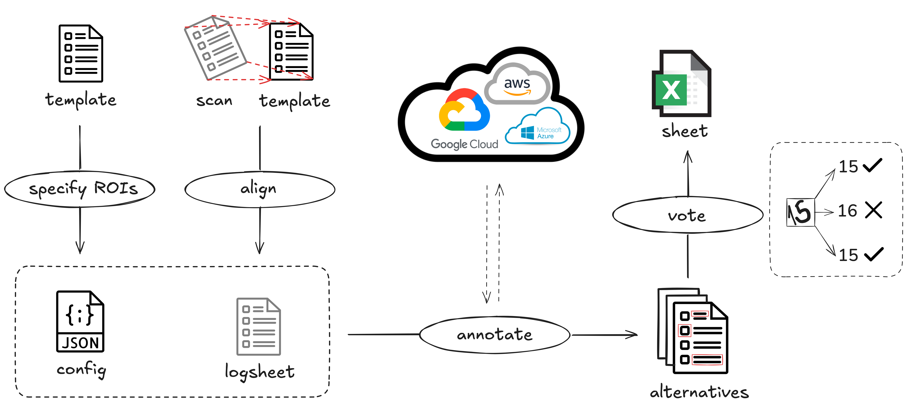

# Summary

`formHTR` is a Python software package for automatic handwritten text recognition (HTR) and extraction from scanned form documents. While the content extraction itself is accomplished using advanced pretrained OCR models, a key step in the process is considering the prior knowledge of the expected contents. That is achieved by the precise, semi-automatic annotation of the regions of interest (ROIs) in the form template, specifying the locations and content types of ROIs. Using this approach in combination with comparing and evaluating outputs from multiple OCR models is designed to support more reliable extraction.

# Statement of need

Large-scale scientific expeditions often collect huge amounts of samples, with a need to record the origin and context of the samples and observed features (metadata). While digital metadata collection methods are becoming more popular, paper forms (so-called *logsheets*) are still the most popular method for their reliability in extreme environments, stability, natural scalability, and ease of use [@VANTAMELEN2004123; @BREWER2016131].

It is necessary to build an infrastructure that processes logsheets automatically with a minimal amount of manual interventions and laborious proofreading. Optical character recognition (OCR) methods [@ocr156468] are used to extract the content from a scanned logsheet, with additional complexity added by the handwritten nature of the content. While training custom models on a particular handwriting style of a person is generally more precise, this approach is impractical for large-scale expeditions with high turnaround of staff and consequently higher amount of distinct handwritings. The use of multiple pretrained general purpose OCR models, allowing consensus or majority decision making, is a more suitable approach.

Just as large-scale expeditions enforce standards on sample collection, they also enforce them on the metadata level. That means standardised logsheets are often developed, and used repeatedly in various sampling scenarios. As a consequence, to digitalise the contents of such logsheets, we can leverage their known structure and expected content types to navigate the OCR methods for more reliable and precise results.

# State of the field

The current OCR landscape of pretrained tools can be split between open-source models and cloud-based services. On the open-source side, there are many tools such as Tesseract OCR [@tesseract_ocr], EasyOCR [@easyocr], OCR4All [@app9224853], and PaddleOCR [@cui2025paddleocr30technicalreport] which provide pretrained models or optionally allow to train custom models. Some of the trade-offs are in accuracy, speed, and deployment complexity. Cloud-based pretrained OCR services, including Google Cloud Vision API [@google_vision_api], Azure AI Vision  [@microsoft_azure_computer_vision_sdk], and Amazon Textract [@amazon_textract], are accessible via APIs and are highly optimised for printed and handwritten text, with some also providing higher-level outputs (e.g. key–value pairs).

Naturally, the combination of multiple tools, models, or services has emerged. Systems such as OCRmyPDF [@ocrmypdf] or unified interfaces like OcrPy [@ocrpy] integrate engines like Tesseract, cloud APIs, and downstream processing into a single pipeline, effectively abstracting over multiple OCR backends. The tool `Handprint` [@handprint] combines multiple cloud services and outputs annotated images or raw results, as well as compares the recognised text against the expected content[^1]. None of these tools integrates a reusable form template, aligns a scan to that template, assigns recognised fragments to named fields, or outputs a table with fused results from several engines by the voting process. Extending any of them would have meant replacing that output model rather than reusing it, so a dedicated extraction pipeline was a more straightforward design.

[^1]: The package is not maintained anymore.

# Software design

`formHTR` is structured into two main steps with an overview in \autoref{fig:overview}. The specification step selects regions of interest (ROIs) from a template and assigns them a meaning. This is achieved by selecting and manipulating the region locations, while the variable names and ROI types are assigned to individual ROIs. The output of the specification step is a config file containing position, name, and type of identified ROIs.



The next step identifies and extracts content from the ROIs. First, the scanned logsheet and its template are aligned to ensure the ROIs actually match the regions in the scanned logsheet (otherwise they would point to potentially empty or generally mismatched regions). While the goal is straightforward, the execution can be problematic, especially when the template has no fiducial markers or the scan quality is low. For this reason, a manual alignment is possible as well.

The aligned logsheet is converted to an image and several OCR models are queried to identify and extract the content. For this purpose, three services are used by calling their respective APIs - Google Cloud Vision [@google_vision_api], Azure AI Vision Read API [@microsoft_azure_computer_vision_sdk], and Amazon Textract [@amazon_textract]. Cloud APIs were preferred to open-source engines because they provide pretrained handwriting recognition without the need to train or host models at expedition scale. Users accept an external dependency, setup and possible usage costs[^2], and the privacy implications of sending scans to third parties; they can enable any subset of the three services, or later add self-hosted backends. All three services output a set of detected words with their location (bounding box) in the image.

[^2]: All services offer a free tier with limited amount of requests per month. The user needs to provide suitable account credentials. A quick start description how to do this is available at the [wiki pages](https://github.com/grp-bork/formHTR/wiki/Setup-services) of the `formHTR` repository.

After collecting the identified contents for each service, the process of binning assigns each captured text fragment (word) to the appropriate ROI. Several cases need to be considered, such as a word spanning over multiple ROIs, multiple words overlapping with a single ROI, or a sentence split into several words (see examples in \autoref{fig:binning}). To find all overlaps for a ROI from all the services, we use `R-tree` [@rtree] to index the regions and capture their overlaps for all services' outputs and the template specification, and consequently use it to effectively query for intersections. Additionally, the logsheet can contain preprinted contents (*residuals*) that do not belong to ROIs, but can be shifted to its boundary box by an imperfect alignment. This is handled by defining the residuals already in the specification step, thus allowing to exclude them from the outputs.


Assuming the words are binned for all services, a majority vote is applied character by character after pairwise alignment of the readings. Ties are broken deterministically by keeping the first service in a fixed order. If a field spans more than three lines, or more than five words on a line, voting is skipped and the first service that returned content is used. Numeric ROIs prefer a numeric parsing of the readings when one is available. The tool works with fewer than three services enabled, with correspondingly less opportunity to resolve disagreements. A more elaborate consensus would need comparable confidence scores or labelled data, which we do not assume, thus implementing a richer rule remains a natural future extension (e.g. allow only values from a dictionary, only content satisfying a regex, only numbers from an integer range, or content satisfying a length threshold).

The output of `formHTR` is an Excel spreadsheet (an `.xlsx` file) with two sheets. `Metadata` sheet has three columns - a variable name coming from the specification, the extracted content as the result of the voting algorithm, and a picture cut out of the scanned (and aligned) logsheet based on the bounding box defined in the specification. This can be used for a quick proofreading of the outputs. `Extra` sheet contains any miscellaneous content that neither falls into any ROI nor was filtered out as a residual. This can typically alert the user to any comments and notes written on unexpected parts of the logsheet.

# Research impact statement

The need for the `formHTR` tool arose during the TRaversing European Coastlines (TREC) expedition[^3]. The tool was developed and continuously optimised for the expedition, and consequently used on a collection of approximately ten thousand double-sided logsheets spanning around a hundred different template types, together providing contextual metadata to more than eighty thousand collected samples. Using `formHTR`, the logsheet templates were annotated and all the scanned logsheets processed. The metadata was extracted and curated, and archived[^4] in the BioSamples database [@courtot2022biosamples]. The contextual metadata is an essential foundation for sample analysis and data production, which, at the time of writing, is in the initial phase.

[^3]: https://www.embl.org/about/info/trec/

[^4]: https://www.ebi.ac.uk/biosamples/samples?text=Traversing+European+Coastlines+%28TREC%29+expedition

# Example workflow

The following is an example workflow in which we first create and annotate ROIs for the template, and consequently process the scanned logsheet, ultimately creating the output Excel spreadsheet.

```
# 1) Create ROI config for a template
formhtr select-rois --pdf-file template.pdf --output-file config.json

# 2) Annotate ROI types and variable names
formhtr annotate-rois --pdf-file template.pdf --config-file config.json --output-file config_annotated.json

# 3) Process a scanned logsheet
formhtr process-logsheet \
  --pdf-logsheet scan.pdf \
  --pdf-template template.pdf \
  --config-file config_annotated.json \
  --output-file output.xlsx \
  --google google_credentials.json \
  --amazon amazon_credentials.json \
  --azure azure_credentials.json
```

# Author Contributions

MT wrote the manuscript and developed the software. JG contributed to the software. SP, MK, and KL contributed via conceptual guidance and contributed to the manuscript.

# AI usage disclosure

Generative AI assistance was used through the Cursor IDE with automatic agent selection, so individual model names and versions were not recorded. It was used to draft tests and documentation, and during JOSS review to help revise this manuscript and author responses. It was not used to design the extraction pipeline or to write the original manuscript. Human authors reviewed, edited, and validated all AI-assisted outputs and made the core design decisions.

# Acknowledgements

We thank the late Peer Bork for general supervision of this work. This publication was enabled by the support of EMBL member states to the TREC expedition (within the framework of EMBL’s Molecules to Ecosystems Programme 2022-2026) and partially funded by the European Union’s Horizon 2020 research and innovation programme (project BIOcean5D with grant agreement No. 101059915). Views and opinions expressed are, however, those of the authors only and do not necessarily reflect those of the European Union. Neither the European Union nor the granting authority can be held responsible for them.

# References
